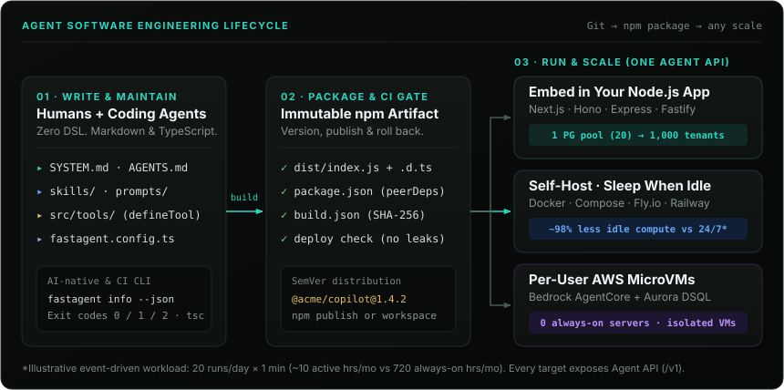

<p align="center">
  <a href="https://fastagent.sh"></a>
</p>

<h3 align="center">The TypeScript runtime for production AI agents.</h3>

<p align="center">
  <strong>English</strong> · <a href="https://github.com/fastagent-sh/fastagent/blob/main/README.zh-CN.md">简体中文</a>
</p>

<p align="center">
  Write agents in <strong>Markdown (<code>SYSTEM.md</code>, <code>AGENTS.md</code>, <code>skills/</code>), typed TypeScript tools, and MCP</strong> — built for both engineers and coding agents.<br>
  Package as a versioned <strong>npm artifact</strong>, <strong>embed</strong> in Next.js, Hono, Express, or Fastify (keeping your auth &amp; database), <strong>self-host</strong> with Docker, or <strong>deploy</strong> to Fly.io, Railway, and AWS AgentCore.
</p>

<p align="center">
  <a href="https://github.com/fastagent-sh/fastagent/actions/workflows/ci.yml"></a>
  <a href="https://www.npmjs.com/package/@fastagent-sh/fastagent"></a>
  <a href="https://github.com/fastagent-sh/fastagent/blob/main/LICENSE"></a>
  <a href="https://nodejs.org"></a>
  <a href="https://github.com/fastagent-sh/fastagent/stargazers"></a>
  <a href="https://x.com/kid7st"></a>
</p>

<p align="center">
  <a href="https://fastagent.sh/docs/quickstart/"><strong>Quickstart</strong></a> ·
  <a href="https://github.com/fastagent-sh/fastagent/tree/main/examples">Examples</a> ·
  <a href="https://fastagent.sh/docs/packaging-and-ci/">Packaging &amp; CI</a> ·
  <a href="https://fastagent.sh/docs/embedding/">Embed</a> ·
  <a href="https://fastagent.sh/docs/deploy/">Self-Host &amp; Deploy</a> ·
  <a href="https://fastagent.sh/docs/">Docs</a> ·
  <a href="https://github.com/fastagent-sh/fastagent/discussions">Discussions</a>
</p>

<p align="center">
  
</p>

## Why FastAgent?

Modern engineering teams build with both **humans and coding agents**. Visual workflow canvases and proprietary graph DSLs break that loop — coding agents cannot reliably edit them, and standard CI cannot type-check or package them. Meanwhile, taking an agent off a laptop into production forces you to build weeks of backend plumbing by hand.

**FastAgent treats an AI agent like normal TypeScript software — and ships the production runtime out of the box:**

| When your agent hits production | What FastAgent gives you |
| --- | --- |
| Coding agents &amp; engineers struggle with proprietary graph DSLs | **Zero DSL:** plain Markdown (`SYSTEM.md`, `skills/`), typed TypeScript tools, MCP, and a non-interactive `--json` CLI |
| Prompts and tools have no clean build, CI gate, or rollback path | **Immutable npm packages:** `fastagent build` runs `tsc` and emits a versioned ESM package (`dist/`) ready for CI &amp; `npm publish` |
| Deploys, crashes, or browser refreshes kill long runs | **Durable sessions** (SQLite, PostgreSQL, Aurora DSQL) and **resumable SSE streams** |
| Webhook retries double-run or corrupt active sessions | **Idempotent `POST /v1/invoke`**, per-conversation locking, and live mid-run **`steer`** |
| Your app already has users, permissions, and a database | **Native Node.js embedding** (`openAgent()` or Fetch handler) sharing your auth &amp; PostgreSQL pool |
| API keys leak into shells or containers; idle servers burn cash | **Declared secrets**, **pre-deploy leak checks**, **OS sandboxing**, **sleep-when-idle hosting**, and **AWS microVMs** |

## Quickstart (5 minutes)

Requires **Node ≥ 24.15**.

```bash
npm i -g @fastagent-sh/fastagent
fastagent init my-agent && cd my-agent
fastagent dev                 # local server with hot reload & SQLite persistence
fastagent invoke "hello"      # send a message through the Agent API
```

**Using a coding agent?** Paste this into Claude Code, Codex, Cursor, or Pi:

> Read https://fastagent.sh/start.md and build an agent in this project.

> **Tip:** Prefer no global install? Run `npx @fastagent-sh/fastagent <command>` (never `npx fastagent`, which is an unrelated package). See the full [Quickstart](https://fastagent.sh/docs/quickstart/).

## The software engineering lifecycle

<p align="center">
  
</p>

### 1. Write &amp; maintain with humans and coding agents

No visual canvas or framework-specific DSL. Every agent is plain Markdown and TypeScript that both your team and coding agents can read, refactor, type-check, and review in Git:

```text
my-agent/
├── fastagent.config.ts   # model, tool permissions, MCP servers, sandbox
├── SYSTEM.md             # system prompt (hot-reloaded in dev)
├── AGENTS.md             # optional operating rules
├── skills/               # reusable Agent Skills (skills/<name>/SKILL.md)
└── src/tools/            # typed TypeScript tools (defineTool + needs())
```

```ts
// fastagent.config.ts
import { defineAgent } from "@fastagent-sh/fastagent";

export default defineAgent({
  model: "anthropic/claude-sonnet-4-6",
  codingTools: false, // or ["read", "bash"] with sandbox: "read-only"
  mcpServers: {
    sentry: {
      type: "http",
      url: "https://mcp.sentry.example.com/mcp",
      headers: { Authorization: "Bearer ${SENTRY_MCP_TOKEN}" },
    },
  },
});
```

### 2. Package, gate in CI, and distribute like a normal npm library

`fastagent build` runs `tsc`, verifies every tool and MCP command, warns on hardcoded credentials, and atomically emits a self-contained ESM npm package in `dist/` (with `index.js`, `index.d.ts`, `build.json` SHA-256 fingerprint, and a `package.json` that places `@fastagent-sh/fastagent` in `peerDependencies` so multi-agent apps share one runtime):

```bash
# In CI (non-interactive, deterministic exit codes 0 / 1 / 2)
fastagent info --json
fastagent build --json          # type-checks and emits immutable dist/ npm package
fastagent deploy check --json   # blocks builds if .secrets/, .env*, or .state/ would leak

# Publish to your private registry (or consume directly in a monorepo workspace)
npm publish ./dist --access restricted
```

Upgrading or rolling back an agent across apps is a standard SemVer version bump (`npm i @acme/saas-copilot@1.4.2`). See [Packaging, Distribution &amp; CI/CD](https://fastagent.sh/docs/packaging-and-ci/).

### 3. Run &amp; scale — from 1 agent to 1,000+ tenants

Pick the hosting shape that fits your workload and budget without changing agent or caller code:

| Scale &amp; workload | Typical bottleneck | FastAgent pattern | Quantified architecture impact |
| --- | --- | --- | --- |
| **1–20 background agents**<br>(PR review, AI SRE, daily briefs) | Always-on containers sit idle 95%+ of the day | **Sleep when idle** on Fly.io (`suspend`) or Railway (App Sleeping) woken via `POST /v1/invoke` | **~98% less idle compute** vs 24/7 containers (for 20 runs/day × 1 min ≈ 10 active hrs/mo vs 720 always-on hrs/mo) |
| **100–1,000+ SaaS tenants**<br>(embedded product copilot) | Per-tenant microservices or 1,000 DB pools exhaust Postgres connections | **Embed in your backend** via `openAgent()` + shared `openPostgresDatabase({ url }, { max: 20 })` (`codingTools: false`) | **0 extra services**; **1 fixed 20-connection Postgres pool** serves 1,000 name-partitioned tenants with 1 schema migration |
| **100–10,000+ isolated users**<br>(per-user sandboxed assistants) | Managing hundreds of always-on VMs and idle costs | **Per-user AWS MicroVMs** on Bedrock AgentCore + serverless Aurora DSQL | **0 always-on servers**; each user gets an on-demand microVM that recycles when idle and resumes cleanly from DSQL |

<sub>Single-writer fencing guarantees one active owner per instance (default limits: `inFlightPerProcess: 100`, `queuedPerSession: 20`). Scale horizontally across instances or automatically per user on AgentCore.</sub>

#### Embed the packaged agent in your Node.js app (Next.js, Hono, Express, Fastify)

```ts
import { baseEnv, openAgent, openPostgresDatabase } from "@fastagent-sh/fastagent";
import copilot from "@acme/saas-copilot"; // versioned npm package from `fastagent build`

const db = openPostgresDatabase({ url: process.env.DATABASE_URL! }, { max: 20 });

const agent = await openAgent(copilot, {
  root: "/var/lib/myapp/tenants/acme",
  name: "tenant-acme",
  database: db, // share one pool across hundreds or thousands of tenants
  secrets: { OPENAI_API_KEY: process.env.OPENAI_API_KEY },
  env: baseEnv(process.env),
});

const session = await agent.sessions.create();
for await (const event of agent.messages.stream({ sessionId: session.id, content: "Summarize my usage" })) {
  if (event.type === "delta" && event.channel === "text") render(event.text);
}
```

#### Self-host with Docker or deploy sleep-when-idle to Fly.io, Railway, or AWS

```bash
# Targets: docker | compose | fly | railway | agentcore
fastagent deploy init fly
fastagent deploy check

# Optional: kernel-enforced OS sandboxing (sandbox-exec / bwrap / Landlock)
fastagent dev --harness dsh --sandbox read-only
```

#### Call from webhooks, cron jobs, CI, or edge workers (`@fastagent-sh/client`)

Zero Node.js dependencies — runs anywhere `fetch` exists, with identical caller code across every host:

```ts
import { connectAgent } from "@fastagent-sh/client";

const agent = connectAgent("https://agent.example.com", {
  apiKey: process.env.AGENT_API_KEY!,
});

// Wakes a sleeping container (up to 600s wait), deduplicates retries, and steers if already running
const reply = await agent.invoke(
  {
    conversation: "incident:inc-415",
    idempotencyKey: webhookEventId,
    whenBusy: "steer",
    content: alertSummary,
  },
  { wait: 300 },
);
console.log(reply.status, reply.answer?.text);
```

## Production examples

Clone a complete working agent from [`examples/`](https://github.com/fastagent-sh/fastagent/tree/main/examples):

| Example | Runs on | Key capabilities |
| --- | --- | --- |
| [**Multi-Tenant SaaS Copilot**](https://github.com/fastagent-sh/fastagent/tree/main/examples/saas-copilot) | Embedded (Hono + PostgreSQL) | Shared DB pool, `codingTools: false`, resumable SSE |
| [**Sandboxed PR Review Agent**](https://github.com/fastagent-sh/fastagent/tree/main/examples/pr-review-agent) | Self-hosted + GitHub Actions | Read-only OS sandbox, per-PR memory, idempotent retries |
| [**Sleep-When-Idle AI SRE**](https://github.com/fastagent-sh/fastagent/tree/main/examples/incident-triage-agent) | Fly.io + Alert Webhooks | Alert deduplication, mid-run `steer`, MCP servers |
| [**Deep Research &amp; Daily Brief**](https://github.com/fastagent-sh/fastagent/tree/main/examples/deep-research-agent) | Self-hosted + External Cron | Long crash-resilient runs, live terminal attach via Pi |
| [**Per-User AWS MicroVM Agent**](https://github.com/fastagent-sh/fastagent/tree/main/examples/agentcore-per-user) | AWS Bedrock AgentCore | Per-user microVM, Aurora DSQL, Secrets Manager, IAM auth |

## When to use FastAgent

| Need | Workflow Frameworks | Raw LLM SDKs | Coding CLIs | **FastAgent** |
| --- | --- | --- | --- | --- |
| **How you write it** | Graph DSLs &amp; chains | Custom loop in code | Local terminal | **Markdown, skills, typed TS tools, MCP (zero DSL)** |
| **Packaging &amp; CI** | App-coupled code | App-coupled code | Not packageable | **Compiled npm packages, `tsc`, `--json` CI gates** |
| **Embed in Node.js** | Separate service / glue | Stateless by default | Not embeddable | **Native `openAgent()` + shared Postgres pool** |
| **Scale &amp; isolation** | DIY hosting &amp; sandbox | DIY hosting &amp; sandbox | Local machine | **Docker, sleep-when-idle cloud, AWS microVMs, OS sandbox** |

<sub>Examples compared: Workflow frameworks (LangGraph, CrewAI), Raw LLM SDKs (Vercel AI SDK, OpenAI SDK), Coding CLIs (Claude Code).</sub>

**Not the right fit if you want:**

- A **visual no-code canvas** for non-engineers → use Dify or n8n.
- An **interactive local coding assistant** only on your laptop → use Claude Code, Codex, or Pi.
- A **static deterministic DAG workflow engine** → use Temporal or Inngest.

## Architecture &amp; operations

Every caller talks through one contract: the [Agent API](https://fastagent.sh/docs/agent-api/). Swap models, storage backends, hosts, or execution harnesses without changing your agent or application code:

```text
Callers (CLI · openAgent · @fastagent-sh/client · client-agentcore · @fastagent-sh/pi-remote)
                                        │  Agent API (/v1)
┌───────────────────────────────────────▼───────────────────────────────────────┐
│ Unified Runtime Layer (@fastagent-sh/fastagent)                               │
│  Build · defineTool · needs() Secrets · Models & Durable Auth · MCP · OTLP    │
└───────────────────┬───────────────────────────────────────┬───────────────────┘
                    │                                       │ (optional, lazy)
         ┌──────────▼──────────┐                 ┌──────────▼──────────┐
         │ pi-durable (default)│                 │ @fastagent-sh/      │
         │ SQLite / PostgreSQL │                 │ harness-dsh         │
         │ / Aurora DSQL       │                 │ + Kernel OS Sandbox │
         └─────────────────────┘                 └─────────────────────┘
```

- **Privacy-safe tracing:** Export cost, token, and tool spans via OpenTelemetry (`OTEL_EXPORTER_OTLP_ENDPOINT`) without logging prompts or answers.
- **Remote CLI &amp; OAuth:** Manage live instances (`fastagent remote add prod <url>`) and run provider OAuth remotely (`fastagent login openai-codex --remote prod`).
- **Live terminal attach:** Inspect or steer running remote sessions from your terminal with [`@fastagent-sh/pi-remote`](https://fastagent.sh/docs/remotes/).

## Packages &amp; documentation

| Package | Role |
| --- | --- |
| [`@fastagent-sh/fastagent`](https://www.npmjs.com/package/@fastagent-sh/fastagent) | Core runtime (`pi-durable`), `openAgent`, `defineTool`, `openPostgresDatabase`, HTTP server, CLI |
| [`@fastagent-sh/client`](https://github.com/fastagent-sh/fastagent/blob/main/packages/client/README.md) | Zero-Node-dep HTTP Agent API &amp; Auth client (`connectAgent`, `connectAuth`) |
| [`@fastagent-sh/client-agentcore`](https://github.com/fastagent-sh/fastagent/blob/main/packages/client-agentcore/README.md) | Zero-Node-dep Amazon Bedrock AgentCore client (`connectAgentCore`, `connectAgentCoreAuth`) |
| [`@fastagent-sh/agentcore`](https://github.com/fastagent-sh/fastagent/blob/main/packages/agentcore/README.md) | AWS AgentCore server runtime, Aurora DSQL adapter, Secrets Manager, CDK construct |
| [`@fastagent-sh/harness-dsh`](https://github.com/fastagent-sh/fastagent/blob/main/packages/harness-dsh/README.md) | Optional DeepSeek Harness (`@deepseek-ai/dsh`) adapter with kernel OS sandboxing (experimental) |
| [`@fastagent-sh/pi-remote`](https://github.com/fastagent-sh/fastagent/blob/main/packages/pi-remote/README.md) | Pi TUI extension (`/fa`) for live terminal access to deployed HTTP or AgentCore instances |

**Docs at [fastagent.sh/docs](https://fastagent.sh/docs/):**
[Overview](https://fastagent.sh/docs/overview/) · [Quickstart](https://fastagent.sh/docs/quickstart/) · [Packaging &amp; CI](https://fastagent.sh/docs/packaging-and-ci/) · [AI Guide](https://fastagent.sh/docs/ai-start/) · [Architecture](https://fastagent.sh/docs/architecture/) · [Agent API](https://fastagent.sh/docs/agent-api/) · [Configuration](https://fastagent.sh/docs/configuration/) · [MCP](https://fastagent.sh/docs/mcp/) · [Embedding](https://fastagent.sh/docs/embedding/) · [Deploy](https://fastagent.sh/docs/deploy/) · [AgentCore](https://fastagent.sh/docs/agentcore/) · [Remotes](https://fastagent.sh/docs/remotes/) · [CLI](https://fastagent.sh/docs/cli/) · [API Reference](https://fastagent.sh/docs/api-reference/)

## Community &amp; status

FastAgent is pre-1.0 with the [Agent API](https://fastagent.sh/docs/agent-api/) as its stable contract. See [releases](https://github.com/fastagent-sh/fastagent/releases), join [GitHub Discussions](https://github.com/fastagent-sh/fastagent/discussions), or read [Contributing](https://github.com/fastagent-sh/fastagent/blob/main/CONTRIBUTING.md), [Code of Conduct](https://github.com/fastagent-sh/fastagent/blob/main/CODE_OF_CONDUCT.md), [Security](https://github.com/fastagent-sh/fastagent/blob/main/SECURITY.md), and the [MIT license](https://github.com/fastagent-sh/fastagent/blob/main/LICENSE).

> ☁️ **Prefer managed hosting?** FastAgent Cloud adds managed multi-instance durability, sleep-when-idle hosting, and observability while self-hosting stays free. [Join the waitlist →](https://tally.so/r/44DVMB)

<p align="center">
  <sub>Powered by</sub>
  <a href="https://pi.dev"></a>
  <sub>(<code>pi-durable</code> &amp; <code>pi-ai</code>), <a href="https://github.com/Effect-TS/effect">Effect</a>, <a href="https://github.com/nodejs/undici">undici</a>, <a href="https://node-postgres.com">node-postgres</a>, and optional OS sandboxing via <a href="https://github.com/deepseek-ai/deepseek-harness">@deepseek-ai/dsh</a>. Scaffolded <code>writing-great-skills</code> vendored from <a href="https://github.com/mattpocock/skills">mattpocock/skills</a>.</sub>
</p>

<p align="center">
  If FastAgent saves you from building agent infrastructure from scratch, <a href="https://github.com/fastagent-sh/fastagent">give it a ⭐</a>.
</p>
