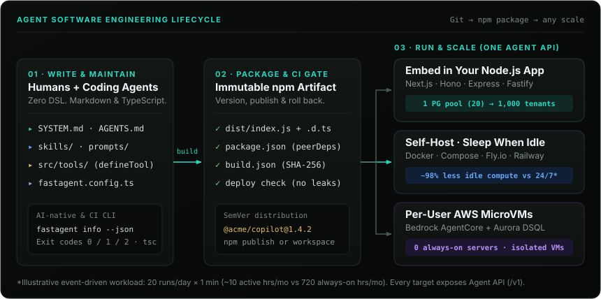

<p align="center">
  <a href="https://fastagent.sh"></a>
</p>

<h3 align="center">面向生产级 AI Agent 的 TypeScript 运行时。</h3>

<p align="center">
  <a href="./README.md">English</a> · <strong>简体中文</strong>
</p>

<p align="center">
  用 <strong>Markdown（<code>SYSTEM.md</code>、<code>AGENTS.md</code>、<code>skills/</code>）、强类型 TypeScript 工具与 MCP</strong> 编写 Agent，天然适配人类工程师与 Coding Agent 共同维护。<br>
  打包为可版本化的 <strong>npm 制品</strong>，直接 <strong>嵌入</strong> Next.js、Hono、Express 或 Fastify（保留你原有的鉴权与数据库），使用 Docker <strong>自托管</strong>，或 <strong>部署</strong> 到 Fly.io、Railway 与 AWS AgentCore。
</p>

<p align="center">
  <a href="https://github.com/fastagent-sh/fastagent/actions/workflows/ci.yml"></a>
  <a href="https://www.npmjs.com/package/@fastagent-sh/fastagent"></a>
  <a href="./LICENSE"></a>
  <a href="https://nodejs.org"></a>
  <a href="https://github.com/fastagent-sh/fastagent/stargazers"></a>
  <a href="https://x.com/kid7st"></a>
</p>

<p align="center">
  <a href="./docs/zh-CN/quickstart.md"><strong>快速上手</strong></a> ·
  <a href="./examples/README.md">示例项目</a> ·
  <a href="./docs/zh-CN/packaging-and-ci.md">打包与 CI</a> ·
  <a href="./docs/zh-CN/embedding.md">嵌入应用</a> ·
  <a href="./docs/zh-CN/deploy.md">自托管与部署</a> ·
  <a href="./docs/zh-CN/README.md">中文文档</a> ·
  <a href="https://github.com/fastagent-sh/fastagent/discussions">社区讨论</a>
</p>

<p align="center">
  
</p>

## 为什么选择 FastAgent？

现代工程团队由 **人类工程师与 Coding Agent** 共同协作。可视化拖拽画布与专有图编排 DSL 破坏了这套协作闭环——Coding Agent 难以可靠修改，标准 CI 也无法对其做类型检查或制品打包。与此同时，把一个 Agent 从本地笔记本推向生产环境，往往需要手写数周枯燥的后端基础设施代码。

**FastAgent 把 AI Agent 当作标准 TypeScript 软件来管理，并开箱提供完整的生产运行时：**

| 生产环境遇到的真实问题 | FastAgent 开箱给出的答案 |
| --- | --- |
| Coding Agent 与工程师难以维护专有图编排 DSL | **零 DSL**：纯 Markdown（`SYSTEM.md`、`skills/`）、强类型 TypeScript 工具、MCP，以及非交互 `--json` CLI |
| 提示词与工具缺少规范构建、CI 门禁与回滚机制 | **不可变 npm 制品**：`fastagent build` 运行 `tsc` 并产出版本化 ESM 包（`dist/`），可直接进 CI 与 `npm publish` |
| 发布部署、进程崩溃或页面刷新导致长任务中断 | **持久化会话**（SQLite、PostgreSQL、Aurora DSQL）与 **断点续传 SSE 流** |
| Webhook 重试导致重复执行或并发写坏活跃会话 | **幂等 `POST /v1/invoke`**、按会话串行控制，以及运行中实时 **`steer` 纠偏** |
| 现有应用已有用户体系、权限控制与数据库 | **原生 Node.js 嵌入**（`openAgent()` 或标准 Fetch Handler），直接复用你的鉴权与 PostgreSQL 连接池 |
| API Key 泄漏到子 Shell 或镜像；常驻容器空转烧钱 | **声明式密钥隔离**、**部署前防泄漏检查**、**内核级 OS 沙箱**、**空闲休眠托管**与 **AWS MicroVM** |

## 5 分钟快速上手

环境要求：**Node ≥ 24.15**。

```bash
npm i -g @fastagent-sh/fastagent
fastagent init my-agent && cd my-agent
fastagent dev                 # 启动本地服务，支持热重载与 SQLite 持久化
fastagent invoke "hello"      # 通过 Agent API 发送第一条消息
```

**正在使用 Coding Agent？** 直接把下面这句粘贴给 Claude Code、Codex、Cursor 或 Pi：

> Read https://fastagent.sh/start.md and build an agent in this project.

> **提示：** 不想全局安装？使用 `npx @fastagent-sh/fastagent <command>`（切勿使用 `npx fastagent`，那是另一个无关的 npm 包）。完整步骤见[快速上手](./docs/zh-CN/quickstart.md)。

## 完整的软件工程生命周期

<p align="center">
  
</p>

### 1. 人类与 Coding Agent 共同编写和维护

没有可视化画布，也没有框架专有 DSL。每个 Agent 都是干净的 Markdown 与 TypeScript 项目，人类团队和 Coding Agent 都能在 Git 中无障碍阅读、重构、做类型检查和代码评审：

```text
my-agent/
├── fastagent.config.ts   # 模型、工具权限、MCP 服务器、沙箱配置
├── SYSTEM.md             # 系统提示词（dev 模式下热重载）
├── AGENTS.md             # 可选的运行规范
├── skills/               # 可复用的 Agent Skills（skills/<name>/SKILL.md）
└── src/tools/            # 强类型 TypeScript 工具（defineTool + needs()）
```

```ts
// fastagent.config.ts
import { defineAgent } from "@fastagent-sh/fastagent";

export default defineAgent({
  model: "anthropic/claude-sonnet-4-6",
  codingTools: false, // 或 ["read", "bash"] 配合 sandbox: "read-only"
  mcpServers: {
    sentry: {
      type: "http",
      url: "https://mcp.sentry.example.com/mcp",
      headers: { Authorization: "Bearer ${SENTRY_MCP_TOKEN}" },
    },
  },
});
```

### 2. 像标准 npm 库一样打包、过 CI 门禁并版本化分发

`fastagent build` 会执行 `tsc` 类型检查、校验工具与本地 MCP 命令、对硬编码明文凭证发出警告，并原子化产出位于 `dist/` 的独立 ESM npm 包（包含 `index.js`、`index.d.ts`、`build.json` SHA-256 防过期指纹，以及将 `@fastagent-sh/fastagent` 和内置 `pi-*` 归入 `peerDependencies` 的 `package.json`，让多 Agent 宿主应用共享同一份运行时）：

```bash
# 在 CI 中运行（非交互，确定性退出码 0 / 1 / 2）
npm exec -- fastagent info --json
npm exec -- fastagent build --json          # 类型检查并产出不可变 dist/ npm 制品
npm exec -- fastagent deploy check --json   # 拦截 .secrets/、.env* 或 .state/ 泄漏进容器上下文

# 发布到私有 npm registry（或在 monorepo workspace 中直接消费）
npm publish ./dist --access restricted
```

跨应用升级或回滚一个 Agent，就是一次标准的 SemVer 版本号变更（`npm i @acme/saas-copilot@1.4.2`）。详见[打包、分发与 CI/CD](./docs/zh-CN/packaging-and-ci.md)。

### 3. 从 1 个 Agent 扩展到 1,000+ 租户

按业务负载和成本结构选择最合适的运行形态，无需重写 Agent 或调用方代码：

| 规模与负载场景 | 传统方案的典型瓶颈 | FastAgent 架构模式 | 量化架构效果 |
| --- | --- | --- | --- |
| **1–20 个后台 Agent**<br>（PR 审查、AI SRE、每日简报） | 常驻容器 95% 以上时间空转 | **空闲休眠（Sleep when idle）**：Fly.io（`suspend`）或 Railway（App Sleeping）配合 `POST /v1/invoke` 按需唤醒 | 相比 24/7 常驻容器**减少约 98% 闲置算力消耗**（按每天 20 次 × 1 分钟 ≈ 每月 10 活跃小时 vs 720 常驻小时测算） |
| **100–1,000+ SaaS 租户**<br>（产品内嵌 Copilot） | 每租户独立微服务或 1,000 个数据库连接池直接打爆 Postgres 连接上限 | **嵌入现有后端**：`openAgent()` + 共享池 `openPostgresDatabase({ url }, { max: 20 })`（`codingTools: false`） | **0 额外微服务**；**1 个固定 20 连接的 Postgres 连接池**承载 1,000 个按 `name` 分区的租户，Schema 仅迁移 1 次 |
| **100–10,000+ 独立隔离用户**<br>（每用户独立沙箱助手） | 维护上百台上千台常驻 VM，闲置成本与运维复杂度失控 | **每用户独立 AWS MicroVM**：Amazon Bedrock AgentCore + 无服务器 Aurora DSQL | **0 常驻服务器运维**；每用户按需分配独立 MicroVM，空闲自动回收，下次调用从 DSQL 无缝续接 |

<sub>单写者租约隔离确保同一实例同一时刻只有一个活跃写进程（默认上限：`inFlightPerProcess: 100`、`queuedPerSession: 20`）。通过多实例或 AgentCore 自动按用户分片实现水平扩展。</sub>

#### 将打包好的 Agent 嵌入你的 Node.js 应用（Next.js、Hono、Express、Fastify）

```ts
import { baseEnv, openAgent, openPostgresDatabase } from "@fastagent-sh/fastagent";
import copilot from "@acme/saas-copilot"; // 由 `fastagent build` 产出的版本化 npm 包

const db = openPostgresDatabase({ url: process.env.DATABASE_URL! }, { max: 20 });

const agent = await openAgent(copilot, {
  root: "/var/lib/myapp/tenants/acme",
  name: "tenant-acme",
  database: db, // 在数百上千个租户间共享同一个连接池
  secrets: { OPENAI_API_KEY: process.env.OPENAI_API_KEY },
  env: baseEnv(process.env),
});

const session = await agent.sessions.create();
for await (const event of agent.messages.stream({ sessionId: session.id, content: "Summarize my usage" })) {
  if (event.type === "delta" && event.channel === "text") render(event.text);
}
```

#### 使用 Docker 自托管，或空闲休眠部署到 Fly.io、Railway 与 AWS

```bash
# 支持目标：docker | compose | fly | railway | agentcore
fastagent deploy init fly
fastagent deploy check

# 可选：启用内核级 OS 沙箱（macOS sandbox-exec / Linux bwrap & Landlock / Windows 受限令牌）
fastagent dev --harness dsh --sandbox read-only
```

#### 从 Webhook、定时任务、CI 或边缘函数调用（`@fastagent-sh/client`）

零 Node.js 依赖——只要有 `fetch` 就能运行，无论 Agent 部署在哪个平台，调用代码完全一致：

```ts
import { connectAgent } from "@fastagent-sh/client";

const agent = connectAgent("https://agent.example.com", {
  apiKey: process.env.AGENT_API_KEY!,
});

// 唤醒休眠容器（最长等待 600s）、对重试去重，并在会话繁忙时实时 steer 纠偏
const reply = await agent.invoke(
  {
    conversation: "incident:inc-415",
    idempotencyKey: webhookEventId,
    whenBusy: "steer",
    content: alertSummary,
  },
  { wait: 300 },
);
console.log(reply.status, reply.answer?.text);
```

## 生产级示例项目

可直接从 [`examples/`](./examples/README.md) 克隆完整可运行的 Agent：

| 示例 | 运行形态 | 核心演示能力 |
| --- | --- | --- |
| [**多租户 SaaS Copilot**](./examples/saas-copilot/README.md) | 嵌入式（Hono + PostgreSQL） | 共享数据库连接池、`codingTools: false`、断点续传 SSE |
| [**沙箱化 PR 审查 Agent**](./examples/pr-review-agent/README.md) | 自托管 + GitHub Actions | 只读内核 OS 沙箱、按 PR 独立记忆、幂等 Webhook 重试 |
| [**空闲休眠 AI SRE**](./examples/incident-triage-agent/README.md) | Fly.io + 告警 Webhook | 告警风暴去重、运行中 `steer` 纠偏、MCP 服务器 |
| [**深度调研与每日简报**](./examples/deep-research-agent/README.md) | 自托管 + 外部 Cron | 崩溃可恢复长任务、通过 Pi 终端实时接入会话 |
| [**每用户 AWS MicroVM Agent**](./examples/agentcore-per-user/README.md) | AWS Bedrock AgentCore | 每用户独立 MicroVM、Aurora DSQL、Secrets Manager、IAM 鉴权 |

## 什么时候选择 FastAgent

| 需求 | 工作流编排框架 | 裸调 LLM SDK | 终端编码 CLI | **FastAgent** |
| --- | --- | --- | --- | --- |
| **编写方式** | 图编排 DSL 与链式抽象 | 应用代码手写工具循环 | 本机交互终端 | **Markdown、Skills、强类型 TS 工具、MCP（零 DSL）** |
| **打包与 CI** | 与宿主代码强耦合 | 与宿主代码强耦合 | 无法打包分发 | **编译为 npm 制品、`tsc` 校验、`--json` CI 门禁** |
| **嵌入 Node.js** | 独立服务或胶水包装 | 默认无状态 | 不可嵌入 | **原生 `openAgent()` + 共享 Postgres 连接池** |
| **扩展与隔离** | 自建托管与沙箱 | 自建托管与沙箱 | 本机权限 | **Docker、空闲休眠云平台、AWS MicroVM、OS 沙箱** |

<sub>对比参考：工作流编排框架（LangGraph、CrewAI）、裸调 LLM SDK（Vercel AI SDK、OpenAI SDK）、终端编码 CLI（Claude Code）。</sub>

**如果你需要以下能力，FastAgent 刻意不作为首选：**

- 面向非技术人员的**可视化无代码拖拽画布** → 请选用 Dify 或 n8n。
- 仅在个人电脑上使用的**本地交互式编程助手** → 请选用 Claude Code、Codex 或 Pi。
- 每一步都提前写死的**静态确定性 DAG 工作流引擎** → 请选用 Temporal 或 Inngest。

## 架构与运维

所有调用方（CLI、进程内嵌入 `openAgent()`、HTTP 客户端 `@fastagent-sh/client`、AWS 客户端 `@fastagent-sh/client-agentcore`、交互终端 `@fastagent-sh/pi-remote`）都通过同一份契约通信：[Agent API](./docs/zh-CN/agent-api.md)。更换模型、存储引擎、部署平台或执行 Harness，都无需改动 Agent 或业务代码：

```text
Callers (CLI · openAgent · @fastagent-sh/client · client-agentcore · @fastagent-sh/pi-remote)
                                        │  Agent API (/v1)
┌───────────────────────────────────────▼───────────────────────────────────────┐
│ Unified Runtime Layer (@fastagent-sh/fastagent)                               │
│  Build · defineTool · needs() Secrets · Models & Durable Auth · MCP · OTLP    │
└───────────────────┬───────────────────────────────────────┬───────────────────┘
                    │                                       │ (optional, lazy)
         ┌──────────▼──────────┐                 ┌──────────▼──────────┐
         │ pi-durable (default)│                 │ @fastagent-sh/      │
         │ SQLite / PostgreSQL │                 │ harness-dsh         │
         │ / Aurora DSQL       │                 │ + Kernel OS Sandbox │
         └─────────────────────┘                 └─────────────────────┘
```

- **隐私安全的链路追踪**：通过 OpenTelemetry（`OTEL_EXPORTER_OTLP_ENDPOINT`）导出成本、Token 与工具调用 Span，绝不记录提示词或回复正文。
- **远程 CLI 与 OAuth 认证**：管理线上实例（`fastagent remote add prod <url>`），并远程完成模型提供商 OAuth 登录（`fastagent login openai-codex --remote prod`）。
- **终端实时接入**：使用 [`@fastagent-sh/pi-remote`](./docs/zh-CN/remotes.md) 从终端直接查看或介入正在运行的远程会话。

## 包清单与文档索引

| npm 包 | 职责 |
| --- | --- |
| [`@fastagent-sh/fastagent`](https://www.npmjs.com/package/@fastagent-sh/fastagent) | 核心运行时（`pi-durable`）、`openAgent`、`defineTool`、`openPostgresDatabase`、HTTP 服务、CLI |
| [`@fastagent-sh/client`](./packages/client/README.md) | 零 Node 依赖的 HTTP Agent API 与远程认证客户端（`connectAgent`、`connectAuth`） |
| [`@fastagent-sh/client-agentcore`](./packages/client-agentcore/README.md) | 零 Node 依赖的 Amazon Bedrock AgentCore 客户端（`connectAgentCore`、`connectAgentCoreAuth`） |
| [`@fastagent-sh/agentcore`](./packages/agentcore/README.md) | AWS AgentCore 服务端运行时、Aurora DSQL 适配器、Secrets Manager 集成、CDK 构造 |
| [`@fastagent-sh/harness-dsh`](./packages/harness-dsh/README.md) | 可选的 DeepSeek Harness（`@deepseek-ai/dsh`）适配器，提供内核级 OS 沙箱（实验性） |
| [`@fastagent-sh/pi-remote`](./packages/pi-remote/README.md) | Pi TUI 扩展（`/fa`），用于从终端交互式接入已部署的 HTTP 或 AgentCore 实例 |

**完整中文文档（[docs/zh-CN/](./docs/zh-CN/README.md)）：**
[产品概览](./docs/zh-CN/overview.md) · [快速上手](./docs/zh-CN/quickstart.md) · [打包与 CI](./docs/zh-CN/packaging-and-ci.md) · [AI 协作开发指南](./docs/zh-CN/ai-start.md) · [技术架构](./docs/zh-CN/architecture.md) · [Agent API](./docs/zh-CN/agent-api.md) · [配置指南](./docs/zh-CN/configuration.md) · [MCP 服务器](./docs/zh-CN/mcp.md) · [嵌入应用](./docs/zh-CN/embedding.md) · [部署指南](./docs/zh-CN/deploy.md) · [AWS AgentCore](./docs/zh-CN/agentcore.md) · [远程实例与客户端](./docs/zh-CN/remotes.md) · [CLI 参考](./docs/zh-CN/cli.md) · [API 参考](./docs/zh-CN/api-reference.md) · [故障排查](./docs/zh-CN/troubleshooting.md)

## 社区与版本状态

FastAgent 当前处于 1.0 前阶段，以 [Agent API](./docs/zh-CN/agent-api.md) 为稳定契约核心。查看 [Releases](https://github.com/fastagent-sh/fastagent/releases)、加入 [GitHub Discussions](https://github.com/fastagent-sh/fastagent/discussions)，或阅读[贡献指南](./CONTRIBUTING.md)、[行为准则](./CODE_OF_CONDUCT.md)、[安全策略](./SECURITY.md)与 [MIT 许可证](./LICENSE)。

> ☁️ **希望免运维全托管？** FastAgent Cloud 将内置多实例持久化、空闲休眠托管与可观测性，同时自托管永久免费。[加入候补名单 →](https://tally.so/r/44DVMB)

<p align="center">
  <sub>Powered by</sub>
  <a href="https://pi.dev"></a>
  <sub>(<code>pi-durable</code> &amp; <code>pi-ai</code>), <a href="https://github.com/Effect-TS/effect">Effect</a>, <a href="https://github.com/nodejs/undici">undici</a>, <a href="https://node-postgres.com">node-postgres</a>, and optional OS sandboxing via <a href="https://github.com/deepseek-ai/deepseek-harness">@deepseek-ai/dsh</a>. Scaffolded <code>writing-great-skills</code> vendored from <a href="https://github.com/mattpocock/skills">mattpocock/skills</a>.</sub>
</p>

<p align="center">
  如果 FastAgent 帮你省去了从零搭建 Agent 生产基础设施的时间，欢迎<a href="https://github.com/fastagent-sh/fastagent">点亮一颗 ⭐</a>。
</p>
